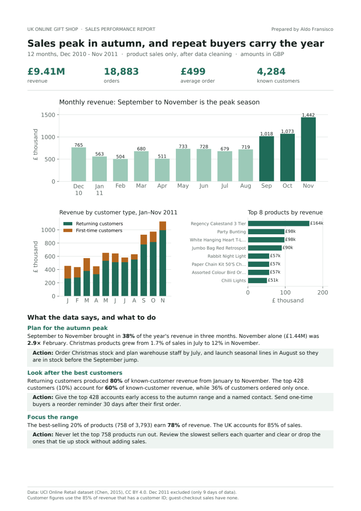

# Online Retail: Monthly Sales Report

A one-page sales performance report for a UK online gift shop, built from one year of cleaned transaction data. It answers the questions a shop owner asks: when do we sell, who buys, and what sells. Each answer comes with a practical action.

**[Read the report (PDF)](reports/sales_report_2011.pdf)**



## Key findings

| | Finding | Action |
|---|---|---|
| **When** | September to November brought in **38%** of the year's £9.41M revenue. November was **2.9×** February. Christmas products grew from 1.7% of sales in July to 12% in November. | Order Christmas stock and plan staff by July; launch seasonal lines in August. |
| **Who** | Returning customers produced **80%** of known-customer revenue (Jan–Nov). The top 428 customers (10%) bring in **60%** of it, while 36% of customers ordered only once. | Early access and a named contact for the top 428 accounts; a reorder reminder for one-time buyers. |
| **What** | The best-selling 20% of products (758 of 3,793) earn **78%** of revenue. | Keep the top 758 products in stock; review slow sellers each quarter. |

## The data

- **Source:** [UCI Online Retail dataset](https://archive.ics.uci.edu/dataset/352/online+retail) (Chen, 2015), CC BY 4.0
- **Input:** `sales_clean.csv` from my [online-retail-cleaning](https://github.com/aldofransisco2008-create/online-retail-cleaning) project (519,740 product sales with cancellations, fees and duplicates removed)
- **Period:** Dec 2010 – Nov 2011, 12 full months. Dec 2011 is excluded because the data stops on 9 December.

## Method notes

- **Revenue** = quantity × unit price, product sales only.
- **Returning vs first-time:** a customer is first-time in the month of their first order in this data. December 2010 is the first month, so every customer looks new there; the customer chart starts in January for that reason.
- **Customer figures** use the 85% of revenue that has a customer ID. Guest-checkout sales have none and are left out of customer analysis rather than guessed.
- **Products** are grouped by stock code, because some products have several spellings of their name.
- **Christmas products** are found by name (Christmas, Xmas, Advent, Santa, Reindeer, Snow), so the share is a close estimate.

## Files

| File | Contents |
|---|---|
| `analyze.py` | Calculates every number and draws the charts |
| `build_report.py` | Lays out the one-page PDF |
| `reports/sales_report_2011.pdf` | The report |
| `reports/metrics.json` | Every number used in the report, including monthly figures and the top 10 products |
| `reports/*.png` | Charts and the report preview |

## How to run

```bash
pip install -r requirements.txt
# put sales_clean.csv from the cleaning project in data/
python analyze.py        # numbers + charts
python build_report.py   # PDF
```

## Tools

Python · pandas · Matplotlib · ReportLab

---

Made by Aldo Fransisco · aldofransisco2008@gmail.com
